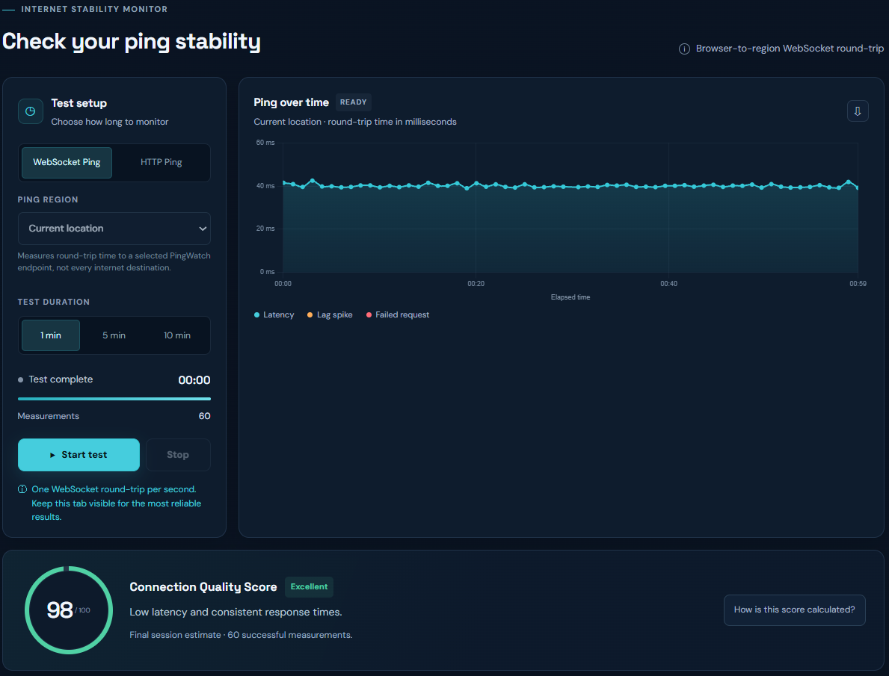

# PingWatch — Internet Stability Monitor

**Monitor your internet connection. Detect lag spikes. Understand connection stability.**

[**Try PingWatch — Free Online Tool**](https://pingwatch.uk)

PingWatch is a free, browser-based internet stability monitoring tool that helps you identify latency fluctuations, jitter, lag spikes, and connection interruptions over time.

Unlike a traditional one-time speed test, PingWatch monitors your connection continuously during a test session, making it easier to spot temporary instability.

No installation or account required.

## Features

- **Live Latency Monitoring** — Watch round-trip timing measurements update in real time.
- **Lag Spike Detection** — Identify sudden increases in measured latency.
- **Jitter Analysis** — Understand how much your latency varies between measurements.
- **Connection Quality Score** — Get a session-based stability assessment from 0 to 100.
- **Stability Timeline** — Visualize stable periods, instability, spikes, and failed probes.
- **Connection Events** — Review notable events detected during your test.
- **Flexible Test Durations** — Run 1-minute, 5-minute, or 10-minute tests.
- **CSV Export** — Download measurement data for further analysis.
- **Saved Results** — Access recent test summaries stored locally in your browser.

## Preview

## How It Works

PingWatch measures browser-to-endpoint round-trip timings using two available modes:

**WebSocket Gaming Ping** measures message round trips over a WebSocket connection.

**HTTP Check** measures HTTP request timing from the browser to the configured endpoint.

These are browser-based measurements. PingWatch does not perform ICMP ping tests, directly measure the latency of specific game servers, or provide a full internet speed test.

## Who Is It For?

PingWatch can be useful for:

- Gamers investigating intermittent connection instability.
- Remote workers experiencing occasional network interruptions.
- Anyone troubleshooting Wi-Fi fluctuations.
- Users who want to understand their internet connection's consistency.

## Learn More

Explore the educational guides:

- [Guides Hub](https://pingwatch.uk/guides)
- [What Is Jitter?](https://pingwatch.uk/what-is-jitter)
- [Ping vs. Latency](https://pingwatch.uk/ping-vs-latency)
- [Diagnose Unstable Internet](https://pingwatch.uk/diagnose-unstable-internet)

## Try PingWatch

**Website:** https://pingwatch.uk

PingWatch is free to use directly from your browser.

## About This Repository

This repository contains public information about PingWatch, including product documentation and screenshots.

The application's source code is maintained in a separate private repository.

## Feedback

Found a bug or have a feature suggestion? Open an issue in this repository or contact us through the [PingWatch contact page](https://pingwatch.uk/contact).

---

Made by [PetruAdv](https://github.com/PetruAdv).
